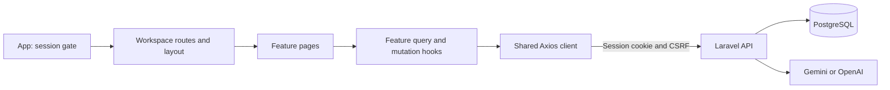

<p align="center"></p>

<h1 align="center">7B AHMED TAMER · Frontend</h1>

<p align="center">Customers, opportunities, and grounded AI — in one sales workspace.</p>

<p align="center">
  
  
  
</p>

<p align="center"><a href="https://github.com/tamourax/CRMbackend">Backend</a> · <a href="docs/ARCHITECTURE.md">Architecture</a> · <a href="docs/REFACTOR.md">Refactor notes</a> · <a href="docs/demo.webm">Demo video</a></p>

## Contents

- [Quick start](#quick-start)
- [Demo accounts](#demo-accounts)
- [Features and preview](#features-and-preview)
- [Architecture](#architecture)
- [Project structure](#project-structure)
- [AI configuration](#ai-configuration)
- [Tests and commands](#tests-and-commands)
- [Branch workflow](#branch-workflow)

## Quick start

**Requirements:** Node.js 24+, npm, and the installed/seeded Laravel backend. PostgreSQL runs behind Laravel; React never connects to it directly.

Clone into sibling directories so the browser-test configuration can find the backend:

```sh
git clone https://github.com/tamourax/CRMbackend.git backend
git clone https://github.com/tamourax/CRMfrontend.git frontend
```

1. Follow the [backend quick start](https://github.com/tamourax/CRMbackend#quick-start) and leave its API running on port `8000`.
2. Open another terminal and run:

```sh
cd frontend
npm ci
npm run dev
```

3. Open **[http://localhost:5173](http://localhost:5173)**.

The default API URL is `http://localhost:8000`. To override it, copy `.env.example` to `.env` and set:

```dotenv
VITE_API_URL=http://localhost:8000
```

Use **localhost** for both browser URLs. Mixing `localhost` and `127.0.0.1` breaks cookie sharing even though both reach your machine. The backend's `FRONTEND_URL` and `SANCTUM_STATEFUL_DOMAINS` must match the frontend hostname and port.

## Demo accounts

Run the backend seeder before signing in.

| Workspace   | Username / email      | Demo password    |
| ----------- | --------------------- | ---------------- |
| Ahmed Tamer | `ahmed@7bahmedtamer.example` | `OrbitDemo!2026` |
| Nour Hassan | `nour@7bahmedtamer.example` | `OrbitDemo!2026` |

These are intentionally public, fictional demo credentials. Each account sees its own 10 Egyptian customer records and 30 deals. Seeded phones use Egypt's `+20` country code, email addresses use reserved `.example` domains, and deal values are shown in Egyptian pounds (EGP). Arabic/English switching sends the selected locale to Laravel and refreshes CRM data so customer, deal, user, status, and stage text changes language. Use two browser profiles or an incognito window to demonstrate isolation. Remove demo accounts before production use.

## Features and preview

| Area            | Included behavior                                                                               |
| --------------- | ----------------------------------------------------------------------------------------------- |
| Sales overview  | Pipeline, won/lost values, stage distribution, top customers, closing and overdue opportunities |
| Customers       | Search, status filters, pagination, details, notes, linked deals, AI relationship summary       |
| Deals           | Stage/date filters, sorting, details, and customer navigation                                   |
| AI assistant    | Independent questions, actual database facts, source links, loading/error/retry states          |
| Sales narrative | On-demand explanation of backend-calculated statistics                                          |
| Responsive UI   | Mobile navigation, horizontally scrollable tables, keyboard focus, reduced motion               |

<details>
<summary><strong>Open the workspace preview</strong></summary>


</details>

More: [customer details](docs/images/customer.png), [assistant](docs/images/assistant.png), [mobile view](docs/images/mobile.png), [recorded demo](docs/demo.webm).

## Architecture



The code follows a **feature-based structure**. Pages render a feature, hooks own its remote state, shared components render reusable UI, and the layout handles navigation. `App.tsx` only decides whether to show login or the authenticated workspace.

- TanStack Query handles server state, request cancellation, loading, and errors.
- Authentication uses Sanctum session cookies and CSRF; no bearer token is stored in localStorage.
- Logout cancels requests and removes private cached data while keeping the observed session query.
- URL filters and prefilled questions are read through React Router.
- `api.ts` owns HTTP/error handling; `format.ts` owns presentation formatting. Money calculations remain in the backend.
- Shared components do not import feature modules. Features use the shared UI, hooks, and HTTP utilities.

See [architecture and dependency rules](docs/ARCHITECTURE.md) and [what changed in the refactor](docs/REFACTOR.md).

## Project structure

```text
src/
├── App.tsx                    # Session gate
├── routes/                    # Authenticated route composition
├── layout/                    # Sidebar, header, footer, and Outlet
├── features/
│   ├── auth/                  # Login page and session mutations
│   ├── customers/             # Customer pages and queries
│   ├── deals/                 # Deal pages and queries
│   ├── reports/               # Sales overview and query
│   └── assistant/             # Chat page and conversation hook
├── components/                # Tables, feedback, badges, AI results
├── hooks/                     # Shared summary mutation
├── lib/                       # HTTP client, formatting, constants
├── types.ts                   # API contracts
└── test/                      # Integration tests and MSW handlers
e2e/                           # Real-browser tests
docs/                          # Architecture, refactor notes, demo
```

## AI configuration

Provider keys belong **only in the backend** `.env`. Never add them to `VITE_*` variables: those are embedded in public browser assets.

The backend supports Gemini and OpenAI. Configure your own key using the [backend instructions](https://github.com/tamourax/CRMbackend#ai-provider-configuration), clear Laravel configuration, restart its server, and refresh the frontend. A key configured on one developer's computer is not included in a repository checkout.

Missing configuration, quota limits, timeouts, and unverifiable answers produce visible errors. Test mocks never substitute for live application responses. AI text is React-escaped; HTML is not executed. Source links and fact cards let the user inspect the underlying records.

## Tests and commands

| Command                | Purpose                                                               |
| ---------------------- | --------------------------------------------------------------------- |
| `npm run dev`          | Local frontend, port `5173`                                           |
| `npm test`             | 16 integration tests using Testing Library and MSW                    |
| `npm run build`        | TypeScript checks and production build                                |
| `npm run format:check` | Verify formatting                                                     |
| `npm run format`       | Apply Prettier formatting                                             |
| `npm audit`            | Dependency audit                                                      |
| `npm run test:e2e`     | Real desktop/mobile browser flow; live model calls skipped by default |
| `npm run demo`         | Record real results or visible provider errors                        |

Before browser tests:

```sh
npx playwright install chromium
npm run test:e2e
```

The backend must already be installed and seeded. Playwright starts or reuses both local servers and does not reset the development database. Integration coverage includes login/logout, relationships, filters, empty/loading/error states, summaries, source links, deep links, and chat retry. Browser tests also check CSRF and cross-account denial.

Live browser verification consumes provider quota and is opt-in:

```sh
# Linux / macOS
RUN_LIVE_AI=1 npm run test:e2e -- e2e/live-ai.spec.ts
```

For PowerShell, set `$env:RUN_LIVE_AI='1'`, run the command, then remove the flag with `Remove-Item Env:RUN_LIVE_AI`.

## Branch workflow

| Branch                                                                                              | Responsibility                                                                |
| --------------------------------------------------------------------------------------------------- | ----------------------------------------------------------------------------- |
| [`refactor/feature-modules`](https://github.com/tamourax/CRMfrontend/tree/refactor/feature-modules) | Split pages/layout/components, isolate feature hooks, add regression coverage |
| [`docs/developer-readme`](https://github.com/tamourax/CRMfrontend/tree/docs/developer-readme)       | Setup guide, architecture, structure, and refactor record                     |
| `main`                                                                                              | Integrated application, using explicit merge commits                          |

Branches are retained on GitHub. Inspect the actual history with `git log --graph --oneline --decorate --all`.

The repository uses LF line endings through `.gitattributes` so formatting checks behave consistently on Windows and Linux.

## Production notes

Authentication credentials stay in Laravel's HttpOnly cookie; no access or refresh tokens are stored in localStorage, sessionStorage, or a React secure-storage library. New login revokes other devices. The UI clears private query data when the API returns `401`, checks session validity on focus and every minute while signed in, and clears previous account data on login/logout. The API's protected `POST /session/refresh` rotates a valid session cookie without extending its maximum lifetime.

Vite development and preview servers send `nosniff`, frame denial, referrer and permissions headers. Configure these headers on the production static host too. A production Content Security Policy should permit scripts/fonts from `'self'`, images from `'self'` and `data:`, connections only to the configured API origin, and use `frame-ancestors 'none'; base-uri 'self'; form-action 'self'`. Existing chart styles require inline style attributes. Use HSTS at the HTTPS host. Vite's preview headers do not configure an external production host.

Build with `npm run build` and serve `dist` with SPA fallback to `index.html`. Host frontend/API under the same parent domain or a same-origin proxy, use HTTPS and secure cookies, and remove demo users. Fonts are self-hosted. CRUD writes, roles, persisted conversations, streaming, and production hosting are outside this assessment version.
