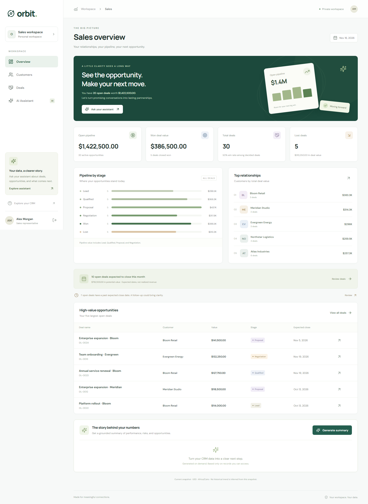

# Orbit CRM · Frontend

A responsive React 19 + TypeScript sales workspace for customers, deals, grounded AI assistance, and PostgreSQL-calculated reports.



Companion: [Laravel backend](https://github.com/tamourax/CRMbackend). Technical documentation and the ERD live in the backend's `docs` directory.

## Run locally

Requirements: Node 24+, npm, and the configured/migrated/seeded backend. Clone the two repositories into sibling directories named `backend` and `frontend` if you want to use the included browser-test server configuration.

```sh
npm ci
npm run dev
```

Open **http://localhost:5173**. The only environment variable is `VITE_API_URL`, default `http://localhost:8000`; copy `.env.example` to `.env` to change it. Never put a provider API key in a `VITE_*` variable: Vite embeds these in browser assets. The API URL is public configuration, not a secret.

Use `localhost` in both browser URLs. The development servers bind to `127.0.0.1`, but cookies must share the hostname. Backend `FRONTEND_URL` and `SANCTUM_STATEFUL_DOMAINS` must match the SPA origin and port. Axios sends credentials and CSRF tokens. No authentication token is stored in localStorage.

Demo-only seed logins: `alex@orbit.example` and `sarah@orbit.example`, password `OrbitDemo!2026`. These are public fictional accounts; never use them in production.

## Features

- Dashboard: pipeline/won/lost statistics, stage distribution, top customers, closing/overdue opportunities, and high-value open deals.
- Customer search/status filters, pagination, details, notes, linked deals, and on-demand summary.
- Deal stage/closing filters, value/date sorting, detail pages, and customer links.
- Read-only deal assistant with suggested questions, authoritative fact cards, source links, and explicit missing configuration/error states.
- On-demand sales narrative using backend-calculated statistics.
- Reusable loading, error/retry, empty, badge, table, pagination, and AI components; mobile navigation and reduced-motion support.

Chat questions are independent; messages are kept only in the page's current session. All text is React-escaped; model HTML is never executed. Logout cancels requests and removes private cached queries. Fonts are self-hosted through Fontsource; the running UI makes no external font requests. The small banner chart is derived from actual stage values, not historical performance.

## AI status

No live key was supplied for this delivery. The application honestly shows **AI is not configured**. The backend contains a real OpenAI Responses adapter and strict read-only tools, but live generation has not been verified. Test mocks do not run in the application. Add a valid key to the **backend** `.env`, clear Laravel configuration, and follow the backend live evaluation checklist.

## Verification

```sh
npm test
npm run build
npm audit
npx playwright install chromium
npm run test:e2e
```

Vitest/Testing Library/MSW cover page integration, authentication, filters, states, summaries/citations, chat, and logout. Playwright starts/reuses both local servers, uses real seeded PostgreSQL data, checks CSRF and two-account isolation, and verifies mobile layout. Backend must be installed and seeded first. Browser tests do not reset its database. API-key-free missing-AI behavior is tested; no live generation is claimed.

## Demo

- [Recorded real-data walkthrough](docs/demo.webm)
- [Customer screenshot](docs/images/customer.png)
- [Assistant screenshot](docs/images/assistant.png)
- [Mobile screenshot](docs/images/mobile.png)
- Re-record using `npm run demo` while both local servers are running and no provider key is configured. The script deliberately records the missing-key state and uses only fictional seeds.

The video is a short automated walkthrough without narration; the backend `docs/DEMO.md` contains a longer technical presentation script. Screenshots/recording are snapshots, so their seeded dates may differ from a later re-seed.

## Structure

`src/pages` contains feature pages; `src/components` contains reusable presentation pieces; `src/lib` owns the API client and formatting; `src/types.ts` defines the backend contract; `src/test` contains mocked HTTP integration tests; `e2e` covers real-browser behavior.

Production uses `npm run build` and serves `dist` with SPA fallback to `index.html`. Host the SPA/API under the same parent domain or use a same-origin proxy; enable HTTPS and secure session cookies. Production hosting is not part of this local assessment delivery.
