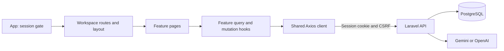

# 7B AHMED TAMER — CRM Frontend

A React sales workspace for Egyptian customer relationships, EGP opportunities, and an AI assistant using actual authorized CRM records.

[Backend repository](https://github.com/tamourax/CRMbackend) · [Complete setup](https://github.com/tamourax/CRMbackend/blob/main/docs/SETUP.md) · [App journey](docs/USER_GUIDE.md) · [Architecture](docs/ARCHITECTURE.md) · [Refactor](docs/REFACTOR.md)

## What can I explore?

| Page                      | Purpose                                                                                                             |
| ------------------------- | ------------------------------------------------------------------------------------------------------------------- |
| Sales overview `/`        | Database-calculated pipeline, won/lost totals, stage distribution, top customers, closing and overdue opportunities |
| Customers `/customers`    | Search/filter contacts, open profiles, notes, associated deals and AI relationship summaries                        |
| Deals `/deals`            | Stage/date filters, sorting, pagination and project/customer details                                                |
| AI assistant `/assistant` | Independent deal questions, backend facts, source links and clear missing-data/provider errors                      |
| Sales AI narrative        | On-demand explanation of the same statistics displayed in the overview                                              |

The app supports Arabic/English preferences, RTL navigation, light/dark mode and mobile layouts. Seeded business records have translated Arabic/English values. Some interface copy and existing record values may remain English where a translation is not supplied; unknown record translations fall back to canonical text.

Customers and deals are seeded, read-only records in this assessment. CRUD editing, registration, admin roles, persisted conversations, historical analytics, streaming and production hosting are outside the implemented scope. The core CRM works without an AI key; AI then shows an unavailable state rather than simulated answers.

## Versions

Application package: **1.0.0**. Exact dependencies come from `package-lock.json`; use `npm ci`.

| Component           | Locked / tested version                                                   |
| ------------------- | ------------------------------------------------------------------------- |
| Node.js / npm       | Last verified **24.15.0 / 11.12.1**; CI uses Node **24.x**                |
| React               | **19.3.1**                                                                |
| React Router        | **7.18.5**                                                                |
| TypeScript          | **5.9.3**                                                                 |
| Vite                | **7.3.8**                                                                 |
| TanStack Query      | **5.107.1**                                                               |
| Axios               | **1.21.1**                                                                |
| Vitest / Playwright | **5.1.0 / 1.65.1**                                                        |
| Backend             | PHP **8.5.12**, Laravel **13.42.0**, Sanctum **4.4.0**, PostgreSQL **17** |

These describe the checkout and verified environment, not the latest upstream versions.

## Quick start

Clone both repositories as siblings:

```sh
git clone https://github.com/tamourax/CRMbackend.git backend
git clone https://github.com/tamourax/CRMfrontend.git frontend
```

1. Follow the [backend setup](https://github.com/tamourax/CRMbackend/blob/main/docs/SETUP.md): install Composer packages, configure PostgreSQL/backend `.env`, generate the application key, and run `php artisan migrate --seed`.
2. Leave the backend running on port `8000`:

```sh
# In backend/
php artisan serve --host=127.0.0.1 --port=8000
```

3. In a second terminal:

```sh
cd frontend
npm ci
npm run dev
```

4. Open **[http://localhost:5173](http://localhost:5173)** and use a demo account below. Health check: [http://localhost:8000/up](http://localhost:8000/up).

Use `localhost` for browser/API URLs. Mixing it with `127.0.0.1` causes cookie/CORS problems even though both resolve locally. Sibling directory names are required by the existing Playwright configuration.

## Environment and AI keys

The frontend has one public environment setting:

```dotenv
VITE_API_URL=http://localhost:8000
```

This is the default. To set it explicitly, copy `.env.example` to `.env` (`cp .env.example .env` in Bash or `Copy-Item .env.example .env` in PowerShell). Restart Vite after editing it; production values are embedded at build time.

The matching backend settings are:

```dotenv
FRONTEND_URL=http://localhost:5173
SANCTUM_STATEFUL_DOMAINS=localhost:5173
```

**AI keys belong only in backend `.env`.** Choose `AI_PROVIDER=openai` with `OPENAI_API_KEY`, or `AI_PROVIDER=gemini` with `GEMINI_API_KEY`, and configure an accessible model. Clear Laravel configuration and restart the API after changing it. Never put provider keys, database passwords or `APP_KEY` in `VITE_*`: the browser can read bundled frontend values. [Provider configuration and full variable reference](https://github.com/tamourax/CRMbackend/blob/main/docs/SETUP.md#environment-reference).

The configuration indicator checks key presence; it does not verify quota/model access. Trigger an AI summary to exercise a live provider request. A checkout does not include a developer's local API key.

## Demo accounts

Seed the backend first. These are intentionally public fictional credentials.

| Workspace   | Email                        | Password         |
| ----------- | ---------------------------- | ---------------- |
| Ahmed Tamer | `ahmed@7bahmedtamer.example` | `OrbitDemo!2026` |
| Nour Hassan | `nour@7bahmedtamer.example`  | `OrbitDemo!2026` |

Each account has **10 Egyptian customer records and 30 deals**. Data includes `+20` phones, `.example` email addresses and EGP values. Re-seeding refreshes expected dates and resets demo passwords.

For account isolation, open Ahmed and Nour in separate browser profiles. Logging into the same account again revokes its earlier devices; the old UI returns to login after its next rejected request/session check. Public demo accounts must not be used with production customer data.

## Discover the app

Start with the overview, open Customers → **NileBridge Technologies**, inspect its notes/deals, follow a deal into its project details, then filter Deals by Negotiation. Generate a customer summary, ask the assistant the five assessment questions, and generate the report narrative. Switch Arabic/English and theme, then try the mobile drawer. Follow the [step-by-step user guide](docs/USER_GUIDE.md) for expected results and reviewer talking points.

[Current overview screenshot](docs/images/overview.png) · [Customer details](docs/images/customer.png) · [Deal project details](docs/images/deal.png) · [Negotiation deals](docs/images/deals.png) · [Mobile screenshot](docs/images/mobile.png) · [Recorded story walkthrough](docs/demo.webm)

The included chaptered walkthrough was captured from the current app with three live AI requests accepted by backend verification. It follows the overview, customer relationship, linked deal, deal assistant, Arabic/RTL and dark-mode preferences, then sign-out. Data values and record IDs vary with each seed. The mobile screenshot is an earlier capture. To record a fresh walkthrough, run `npm run demo` with both apps running, seeded records, Chromium, and a working AI provider configuration; the recording script only replaces the video after every live AI request succeeds.

## Architecture



Pages own presentation and local forms/filters. Feature hooks own remote state through TanStack Query. Shared components supply reusable UI; shared utilities own HTTP/error handling and display formatting. Laravel performs authorization, database queries, money calculations and provider calls. React never connects directly to PostgreSQL or an AI provider.

`App.tsx` chooses login or workspace. `WorkspaceLayout` handles navigation; `WorkspaceRoutes` selects the page. The shared layer does not import feature modules. [Detailed dependency rules and flows](docs/ARCHITECTURE.md).

## Project structure

```text
src/
  App.tsx                  Session gate and session-expiry handling
  main.tsx                 Query, router, locale and theme providers
  routes/                  Workspace route composition
  layout/                  Responsive navigation, header and workspace shell
  features/
    auth/                  LoginPage, authQueries.ts
    customers/             Customer list/detail, customerQueries.ts
    deals/                 Deal list/detail, dealQueries.ts
    reports/               Sales overview, reportQueries.ts
    assistant/             Chat page and useDealAssistant
  components/              Shared buttons, panels, covers, stats, tables, AI output
  hooks/                   Shared AI summary mutation
  preferences/             Locale and theme providers
  locales/                 English/Arabic JSON dictionaries
  lib/                     Axios, display formatting and stage constants
  types.ts                 API contracts
  styles.css               Ordered stylesheet entry point
  styles/                  Tokens, base/layout, components, features, responsive rules
  test/                    Integration tests and test-only API handlers
public/                    Static icon and project illustration
e2e/                       Real PostgreSQL browser flows
docs/                      Architecture, user journey and refactor record
```

## Reusable UI and styles

| Shared module                                    | Use                                                                |
| ------------------------------------------------ | ------------------------------------------------------------------ |
| `Button`, `ButtonLink`                           | `primary`, `secondary`, `light` variants; native button/link props |
| `Panel`, `PanelHeading`                          | Shared section and heading layout                                  |
| `OverviewCover`                                  | Customer/project cover variants                                    |
| `StatCard`                                       | Metric card with green/blue/purple/sand icon tone                  |
| `PageHeader`, `Badge`, `DealTable`, `Pagination` | Shared page/table patterns                                         |
| `Loading`, `ErrorState`, `Empty`                 | Consistent loading/error/empty states                              |
| `AiPanel`, `AiContent`                           | Summary generation, facts, source references and limitations       |

`styles/tokens.css` defines `--font-*` families and `--text-*` sizes. The stylesheet entry point then imports foundation, layout, components, reports, tables, details, assistant, login, and responsive rules in that order. Preserve import order and existing classes when extending styles. Themes and RTL use the existing HTML attributes. [Refactor decisions](docs/REFACTOR.md).

## Authentication and data boundaries

Laravel Sanctum uses HttpOnly session cookies and CSRF; no access/refresh bearer tokens are stored in browser JavaScript storage. Login clears old account cache. Logout and rejected `401` requests clear private data. The frontend checks validity on focus and every minute while signed in. Backend single-device/expiry checks are authoritative.

Language changes send `Accept-Language` and invalidate cached queries to fetch localized records; stage/status codes stay stable while labels change. Amounts arrive as exact decimal strings; display helpers format EGP and suppress unnecessary `.00`. React escapes provider text and does not execute returned HTML.

## Tests and commands

| Command                                     | Purpose                                                     |
| ------------------------------------------- | ----------------------------------------------------------- |
| `npm ci`                                    | Install locked dependencies                                 |
| `npm run dev`                               | Local Vite server on `5173`                                 |
| `npm test`                                  | 16 integration tests with Testing Library and test-only MSW |
| `npm run build`                             | TypeScript checks and production assets                     |
| `npm run preview`                           | Preview a built application locally                         |
| `npm run format:check`                      | Check Prettier formatting                                   |
| `npm audit`                                 | Dependency advisories                                       |
| `npm run test:e2e -- e2e/workspace.spec.ts` | Desktop/mobile real-API browser tests                       |
| `npm run demo`                              | Record current local application behavior                   |

Before browser tests, run `npx playwright install chromium` and prepare the sibling backend with migrations/seeding. Playwright starts or reuses local servers. Tests do not reset development data, but logging into demo accounts revokes their earlier sessions. Test processes should not compete for the same accounts.

Last local verification passed **16 integration tests**, **2 desktop/mobile browser tests**, and the production build; backend passed **49 tests / 241 assertions**. Four backend live-AI tests remained skipped. Live tests require `RUN_LIVE_AI=1`, a valid provider key and quota. [Testing details](https://github.com/tamourax/CRMbackend/blob/main/docs/TESTING.md).

## Troubleshooting and production

For CORS/`419`, check consistent hostnames, stateful domains, CSRF and local cookie settings. For `401`, sign in again; another login or session expiry may have revoked the session. For AI `503`, check backend provider settings/model/quota rather than adding frontend keys. [Complete troubleshooting](https://github.com/tamourax/CRMbackend/blob/main/docs/SETUP.md#troubleshooting).

Build with the production API URL and serve `dist/` with SPA fallback to `index.html`. Use HTTPS and a same-site frontend/API arrangement or same-origin proxy. Configure security headers at the static host; Vite development/preview headers do not configure external hosting. Existing charts require inline style attributes in any production CSP. Fonts are self-hosted. The repositories do not provision production hosting.

Feature/refactor branches are retained, including `refactor/shared-ui-and-styles`. History contains fast-forward integration and earlier merge commits. Use `git log --graph --oneline --decorate --all` to inspect it. [Backend security guide](https://github.com/tamourax/CRMbackend/blob/main/docs/SECURITY.md) · [Arabic technical discussion](https://github.com/tamourax/CRMbackend/blob/main/docs/REVIEW_GUIDE_AR.md).
